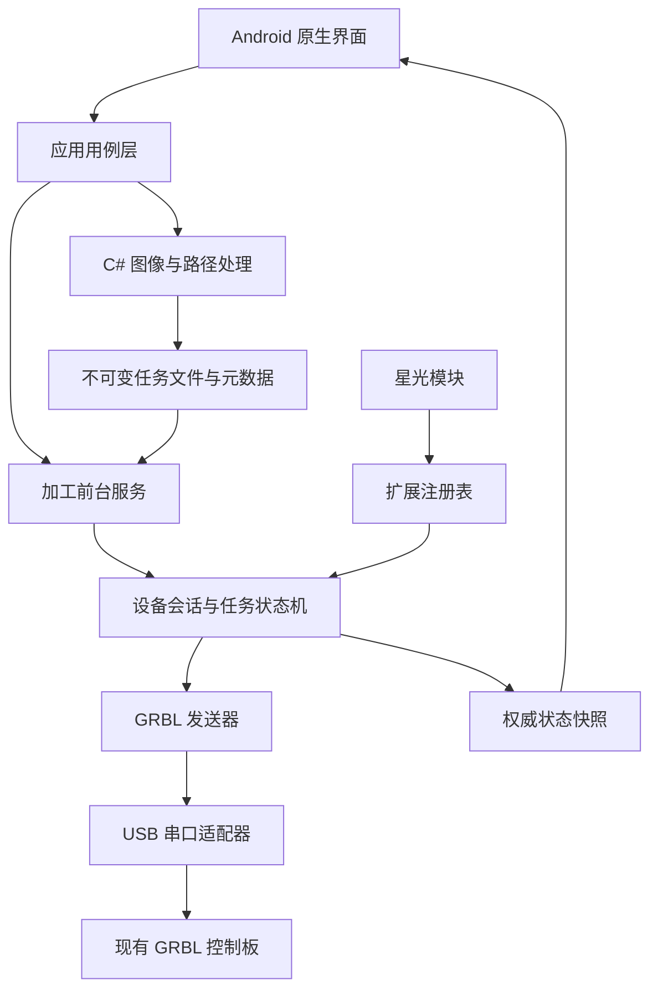

# Android 激光雕刻控制系统：完整技术方案与 Agent 实施任务书

文档版本：1.1  
整理日期：2026-11-07  
适用对象：负责架构、开发、测试及交付的编程 Agent  
产品方向：通用 Android GRBL 控制软件，独立的星光设备支持模块  
主技术栈：C#、.NET for Android、Android 原生 Views、SkiaSharp

> **执行要求：优先复用本文列出的优秀可用开源库与现有实现。每个基础模块先完成复用评估与接入验证，再决定需要自行实现的部分。USB 驱动、基础绘图、SVG 渲染、多边形运算及已有加工算法，均按“复用现成能力、封装项目接口、补充适配与测试”的顺序开发。**

## 目录

1. 项目目标与约束
2. 开源优先复用原则与执行门槛
3. 开源项目清单与复用决策
4. 开始工作前的仓库检查
5. 技术栈与版本管理
6. 系统架构与依赖边界
7. 工程目录
8. LaserGRBL 核心抽取
9. 核心接口
10. USB 连接与设备识别
11. Android 前台执行服务
12. 状态模型与状态同步
13. GRBL 协议与发送调度
14. 暂停、继续、取消与完成
15. 文件、任务与执行记录
16. G-code 导入与检查
17. 位图处理与光栅生成
18. SVG 与几何处理
19. 路径预览与估时
20. 移动界面
21. 星光扩展接口
22. 持久化与日志
23. 可靠性与设备操作要求
24. 测试方案
25. 性能验证
26. 分阶段实施与验收
27. 构建与发布
28. 编程 Agent 执行指令

## 1. 项目目标与约束

开发可独立发布的 Android 应用，通过手机 USB OTG 直接连接现有 GRBL 控制板，完成作品准备、设备操作、任务执行和状态查看。

### 1.1 产品划分

| 部分 | 职责 |
|---|---|
| 通用应用 | 文件导入、图像处理、G-code 生成、预览、USB 连接、GRBL 控制、任务管理 |
| 星光支持模块 | 机型资料、能力配置、参数预设、校准引导、固件差异适配 |

通用应用在未加载星光模块时，应完整支持经过验证的标准 GRBL 设备。星光模块独立维护源码和版本，通过公开扩展接口接入。

### 1.2 已确定约束

- 目标平台为 Android。
- 主语言为 C#，优先复用 LaserGRBL 的适用代码。
- 使用 .NET for Android 直接开发原生 Android 应用。
- 界面采用 Android Views、XML 布局和 AndroidX。
- 保留雕刻机现有控制板、固件和连接方式。
- 使用 USB OTG 数据连接；加工期间手机持续承担任务发送。
- 应用可在无互联网环境中工作。
- 通用核心保持独立类库，支持桌面自动化测试。
- 工程默认采用兼容复用代码的开源发布路线。
- 首版插件采用编译期注册，机型资料采用声明式配置包。
- 不实施 ESP32 网关、控制板替换或 iOS 客户端。

### 1.3 首个完整版本

1. USB 串口连接、识别和状态读取。
2. 受限点动、工作原点设置和按能力开放回零。
3. G-code 导入、检查、二维预览。
4. 开始、暂停、继续、取消。
5. 后台执行、通知、任务历史和错误记录。
6. PNG/JPG 基础处理与光栅生成。
7. 基础 SVG 轮廓加工。
8. 独立星光模块。

先发布完成 G-code 加工闭环的版本，再扩充图像、SVG 和设备功能。

## 2. 开源优先复用原则与执行门槛

### 2.1 开发顺序

每个模块按照以下顺序推进：

1. 查阅本文推荐库的官方仓库、源码、许可证和当前维护状态。
2. 固定具体版本或提交。
3. 建立最小接入示例。
4. 验证 Android 构建、基础功能、线程行为和资源释放。
5. 将库封装到本项目接口后面。
6. 编写与本项目实际需求对应的测试。
7. 实现上游库尚未覆盖的项目功能。

**禁止在未完成复用评估前，从零开发与成熟依赖重复的 USB 串口驱动、基础绘图引擎、通用 SVG 渲染器或多边形布尔运算库。**

### 2.2 各类能力的优先策略

| 能力 | 优先策略 |
|---|---|
| USB 串口 | 直接接入 UsbSerialForAndroid，应用层封装连接与故障策略 |
| 位图与绘图 | 使用 SkiaSharp，应用层实现加工语义 |
| SVG 预览与栅格化 | 接入 Svg.Skia |
| 多边形裁剪、偏移 | 使用固定版本 Clipper2 C# 实现 |
| 光栅与向量加工算法 | 先审查 LaserGRBL 的可抽取代码 |
| GRBL 能力与解析 | 审查 LaserGRBL、ioSender，整理可复用纯逻辑 |
| Android 产品流程 | 学习 LaserGRBL Mobile、grblcontroller |
| 设备扩展体系 | 学习 MeerK40t、UGS 的职责划分，形成 C# 接口 |
| 任务事务、状态权威、Android 生命周期 | 按本文的产品约束实现和集成 |

### 2.3 自行实现的记录要求

采用自行实现时，在 ADR 中说明：

- 已调查的库和具体版本。
- 接入试验结果。
- 未覆盖的功能及实际影响。
- 自行实现的范围。
- 维护责任和测试方法。

常规适配由 Agent 根据证据自主推进，记录决策。避免把每项库选型转化成等待用户确认的阻塞点。

### 2.4 依赖隔离

- 第三方类型尽量留在适配器内部。
- 对外使用本项目的领域模型。
- 版本升级通过适配器测试和黄金样本验证。
- 优先组合现成库；必要修改保持最小补丁并记录上游差异。
- 复用代码同时复用适用的测试素材，保留来源。

### 2.5 复用交付物

必须维护：

```text
third-party/manifest.json
third-party/notices/
docs/reuse-matrix.md
docs/adr/0006-third-party-code-reuse.md
```

`reuse-matrix.md` 的每一项填写候选、版本、许可、复用方式、验证结果和决定。

## 3. 开源项目清单与复用决策

以下为前期调查结果。正式接入时记录当前固定版本与实测结果。

| 项目 | 许可／技术 | 主要价值 | 本项目决策 |
|---|---|---|---|
| [LaserGRBL](https://github.com/arkypita/LaserGRBL) | C#，GPLv3 或后续版本 | 光栅转换、向量转换、G-code、参数和协议经验 | 按模块抽取适用代码 |
| [anotherlab/UsbSerialForAndroid](https://github.com/anotherlab/UsbSerialForAndroid) | C#，MIT | Android USB 串口 | 首选直接接入 |
| [LUJIAN2020/UsbSerialForAndroid.Net](https://github.com/LUJIAN2020/UsbSerialForAndroid.Net) | C#，MIT | .NET Android USB 及示例 | 参考服务封装与接入案例 |
| [mik3y/usb-serial-for-android](https://github.com/mik3y/usb-serial-for-android) | Java，MIT | USB 驱动上游、芯片支持与排错 | 对照驱动修复，必要时绑定 |
| [SkiaSharp](https://github.com/mono/SkiaSharp) | C#，MIT | 图像、二维绘制、Android 视图 | 首选图像与绘制基础 |
| [Svg.Skia](https://github.com/wieslawsoltes/Svg.Skia) | C#，MIT | SVG 加载、预览、栅格化 | 接入预览模块 |
| [Clipper2 C#](https://github.com/AngusJohnson/Clipper2/tree/main/CSharp) | C#，Boost-1.0 | 多边形布尔运算与偏移 | 固定版本、封装几何接口 |
| [ioSender](https://github.com/terjeio/ioSender) | C#，仓库主许可证 BSD-3-Clause | GRBL/grblHAL、G-code 解析、设备能力 | 审查纯逻辑，学习协议组织 |
| [LaserGRBL Mobile](https://github.com/ra1nyxin/LaserGRBL-Mobile) | Kotlin/Compose，Apache-2.0 | Android 操作流程、转换、测试 | 产品与测试参考 |
| [grblcontroller](https://github.com/zeevy/grblcontroller) | Java，GPL-3.0 | 字符计数发送、USB/蓝牙、后台服务 | 学习长任务和流控 |
| [UGS](https://github.com/winder/Universal-G-Code-Sender) | Java；逐模块核对许可 | 多控制器、G-code、通信分层 | 架构参考 |
| [MeerK40t](https://github.com/meerk40t/meerk40t) | Python，MIT | 多设备驱动与扩展体系 | 设备扩展架构参考 |

### 3.1 已核查的接入信息

- anotherlab 的串口库项目已采用 `net10.0-android`，提供 C# 驱动和示例。
- LUJIAN2020 项目在前期检查时目标为 .NET 8/9 Android，包含 MAUI 和 Avalonia 示例。
- ioSender 的 CNC Core 工程包含 .NET Framework、WPF 和 WinForms 依赖；抽取围绕纯协议和几何逻辑进行。
- Clipper2 原作者仓库已归档，维护交接到 [PolyClipping/Clipper2](https://github.com/PolyClipping/Clipper2)。交接说明以 C++ 后续维护为主。本项目固定现有 C# 版本并承担升级验证。
- MeerK40t 在调查时标注为低维护阶段，适合学习扩展结构。

### 3.2 LaserGRBL Mobile 的参考方式

前期源码检查固定到 `bb9ed4b718ce1cf39df9002a82cf7d2d22d40814`。核心文件：

```text
core/GcodeStreamer.kt
core/GrblParser.kt
core/GcodeParser.kt
core/ImageToGcodeConverter.kt
core/SvgToGcodeConverter.kt
core/BoundaryPreviewPlanner.kt
serial/UsbSerialController.kt
app/LaserViewModel.kt
```

优先吸收移动流程、参数组织、转换功能和测试输入。

该快照的产品化改进清单：

| 已检查行为 | 本项目要求 |
|---|---|
| error 后累计错误并继续发送 | 进入明确故障处理 |
| 应答等待使用持续 Channel 等待 | 加入超时、断开与取消 |
| 发送暂停指令后立即标记暂停 | 等待控制器保持状态 |
| 全部应答后报告任务发送完成 | 独立判定机械执行完成 |
| 发送器由 viewModelScope 承载 | 服务持有设备和执行生命周期 |
| stop 取消发送并发出 feed hold | 区分保持、取消及规划缓冲处理 |

README 记录了单元测试、Debug APK 与自动构建，真机验证为待办。Agent 对复用结果建立自己的验证记录。

### 3.3 代码来源和许可记录

```json
{
  "component": "LaserGRBL raster conversion",
  "repository": "https://github.com/arkypita/LaserGRBL",
  "commit": "接入时固定",
  "sourceFiles": [],
  "license": "GPL-3.0-or-later",
  "localFiles": [],
  "modifications": [],
  "tests": []
}
```

保留源码版权头。逐文件检查第三方许可。项目按兼容 GPL 复用代码的路线发布，提供对应源码及第三方声明。产品使用独立名称，并在关于页说明来源关系。

## 4. 开始工作前的仓库检查

Agent 首先：

1. 读取适用的 AGENTS.md。
2. 检查分支、已有项目和未提交变更。
3. 保留用户文件与已有研究产物。
4. 找出现有协议模拟器、测试和设备日志。
5. 建立独立 Android 产品目录。
6. 将旧原型用于行为参考和测试素材。

先形成以下 ADR：

```text
0001-android-only-and-csharp.md
0002-native-android-ui.md
0003-service-owned-device-session.md
0004-grbl-streaming-and-completion.md
0005-device-extension-contract.md
0006-third-party-code-reuse.md
```

每份包含决策、依据、实现影响与验证方式。

## 5. 技术栈与版本管理

| 层次 | 选型 |
|---|---|
| Android | .NET for Android，net10.0-android |
| 通用类库 | net10.0 |
| UI | 原生 Views、XML、AndroidX |
| 页面 | 单 Activity、Fragments |
| UI 状态 | AndroidX ViewModel、不可变状态 |
| 绘图 | SkiaSharp Android 原生适配 |
| USB | anotherlab/UsbSerialForAndroid |
| 数据库 | Microsoft.Data.Sqlite，配套 Android SQLite 原生依赖 |
| JSON | System.Text.Json |
| 异步 | Task、CancellationToken、Channels |
| 日志 | Microsoft.Extensions.Logging、滚动日志 |
| 测试 | xUnit |
| CI | .NET CLI、Android SDK、GitHub Actions |

最低 Android 版本初定 API 29。目标 SDK 按正式接入时的稳定工具链和发布要求确定。

固定 SDK、workload、Android Build Tools、NuGet、原生依赖和上游提交。维护 global.json、Directory.Packages.props、packages.lock.json。

运行时、Android workload 与各依赖分别记录支持周期。先验证最小构建和依赖接入，再开发完整功能。

## 6. 系统架构与依赖边界



前台服务拥有串口、会话与活动任务。页面负责交互和展示。图像转换与设备执行各自运行。所有写入经过统一调度器。

Domain 只依赖基础运行库；Application 依赖 Domain 和接口；Android 工程完成装配；星光模块依赖扩展契约；通用核心不引用星光实现。

## 7. 工程目录

```text
LaserMobile/
  global.json
  Directory.Build.props
  Directory.Packages.props
  LaserMobile.sln
  src/
    LaserMobile.Android/
      Activities/
      Fragments/
      ViewModels/
      Views/
      Services/
      Notifications/
      Permissions/
      Resources/
      Composition/
    LaserMobile.Domain/
      Devices/
      Jobs/
      Geometry/
      Parameters/
      Errors/
    LaserMobile.Application/
      Commands/
      Queries/
      Workflows/
      State/
      Ports/
    LaserMobile.Grbl/
      Parsing/
      Streaming/
      Realtime/
      Capabilities/
      Diagnostics/
    LaserMobile.Cam/
      Raster/
      Vector/
      Gcode/
      Preview/
      Estimation/
    LaserMobile.Imaging.Skia/
    LaserMobile.Transport.AndroidUsb/
    LaserMobile.Persistence/
    LaserMobile.Extensions.Abstractions/
    LaserMobile.Extensions.StandardGrbl/
    LaserMobile.Extensions.Xingguang/
  tests/
    LaserMobile.Domain.Tests/
    LaserMobile.Grbl.Tests/
    LaserMobile.Cam.Tests/
    LaserMobile.Application.Tests/
    LaserMobile.Persistence.Tests/
    LaserMobile.Android.Tests/
  tools/
    LaserMobile.GrblSimulator/
    LaserMobile.TranscriptReplay/
  fixtures/
    images/
    svg/
    gcode/
    grbl-transcripts/
    device-profiles/
  docs/
    adr/
    protocol/
    hardware/
    testing/
    release/
    reuse-matrix.md
  third-party/
    manifest.json
    notices/
```

## 8. LaserGRBL 核心抽取

| 原模块 | 抽取要求 |
|---|---|
| GrblCommand | 命令语义与界面颜色、显示信息分离 |
| GrblFile | 文件读取、路径分析、生成、估时各自分离 |
| RasterConverter | 保留适用算法，替换 Windows 图像接口 |
| SvgConverter | 抽取几何与 G-code 生成 |
| GrblCore | 分离会话、状态机、发送器和传输 |
| ComWrapper | 接入 Android 传输抽象 |
| WinForms/SharpGL | 使用原生页面与 SkiaSharp 实现对应功能 |

顺序：建立样本 → 记录依赖 → 替换平台类型 → 验证输出 → 测量性能 → 优化。

图像算法接收像素缓冲或灰度矩阵，输出路径／G-code；UI 更新由上层处理。

几何统一为毫米、double；像素索引使用整数；数值输出使用 InvariantCulture。舍入只在明确的输出边界执行。

## 9. 核心接口

```csharp
public interface IByteTransport : IAsyncDisposable
{
    Task OpenAsync(TransportOptions options, CancellationToken cancellationToken);
    ValueTask WriteAsync(ReadOnlyMemory<byte> data, CancellationToken cancellationToken);
    IAsyncEnumerable<ReadOnlyMemory<byte>> ReadAsync(CancellationToken cancellationToken);
    Task CloseAsync(CancellationToken cancellationToken);
}

public interface IDeviceSession
{
    DeviceSnapshot Snapshot { get; }
    IAsyncEnumerable<DeviceSnapshot> ObserveAsync(CancellationToken cancellationToken);
    Task<CommandReceipt> ExecuteAsync(DeviceCommand command, CancellationToken cancellationToken);
}

public interface IJobStore
{
    Task<JobDescriptor> CommitAsync(PreparedJob job, CancellationToken cancellationToken);
    Task<Stream> OpenContentAsync(JobId jobId, CancellationToken cancellationToken);
    Task SaveExecutionAsync(JobExecution execution, CancellationToken cancellationToken);
}
```

传输读取必须明确缓冲区所有权。使用池化内存时引入拥有者对象和释放约定，避免复用缓冲覆盖消费中的数据。

类型化命令至少包含：

```text
Connect / Disconnect / RefreshStatus / ReadConfiguration
Jog / CancelJog / SetWorkOrigin
StartJob / PauseJob / ResumeJob / CancelJob
```

原始终端首版仅在空闲状态开放，并通过同一调度器执行。

## 10. USB 连接与设备识别

适配器负责枚举、权限、端口选择、连接、串口设置、DTR/RTS、读取、拔插及释放。

身份包含 VID/PID、产品名称、可用的序列号、端口索引、GRBL banner、$I、固件能力和用户选择的 profile。

VID/PID 用于驱动匹配；机型结合固件与用户选择确认。

连接流程：

```text
发现设备 → 权限 → 打开串口 → 收集启动输出
→ 查询状态 → 空闲时读取身份与配置 → 建立能力 → 发布快照
```

常见串口配置为 115200、8N1。实际配置来自已确认资料。DTR/RTS 与连接复位策略由 profile 定义；首次接入记录打开端口是否复位主控。

未知字段显式保存为未知。回零、软限位、激光模式、屏障等能力由证据开放。

## 11. Android 前台执行服务

建立 DeviceExecutionService，结合启动服务与绑定服务。

负责 USB 会话、发送队列、实时调度、执行状态、查询、日志、持久化与通知。Activity 绑定服务提交命令和订阅快照。

实现要求：

- 声明 connectedDevice 前台服务类型及所需权限。
- 由用户前台操作触发连接和任务。
- 按平台时限展示前台通知。
- 通知显示设备、任务、状态和允许操作。
- 通知操作携带 ExecutionId 与会话代次。
- 服务拒绝旧通知与旧会话命令。
- 活动任务按需要持有 CPU 唤醒锁，终止路径释放。
- 串口关闭、异常、用户退出与系统回收具有统一清理路径。
- Android 版本相关的通知权限、PendingIntent 和接收器注册要求建立测试。

进程重新启动：加载历史 → 未结束执行记 Interrupted → 新 RuntimeSessionId → 等待用户连接与检查 → 新执行。

页面销毁、旋转和重新进入页面通过快照恢复显示。

## 12. 状态模型与状态同步

| 维度 | 状态 |
|---|---|
| USB | Disconnected、PermissionPending、Connecting、Connected、Lost |
| 控制器 | Unknown、Idle、Run、Hold、Jog、Home、Alarm、Door、Check、Sleep |
| 准备 | Imported、Validating、Preparing、Ready、Rejected |
| 执行 | Starting、Running、Pausing、Paused、Draining、Cancelling、Completed、Cancelled、Interrupted、Failed |

USB 状态由适配器产生；控制器状态来自固件；准备状态来自流水线；执行状态由服务结合证据产生。

```csharp
public sealed record DeviceSnapshot(
    Guid RuntimeSessionId,
    long ControllerEpoch,
    long Sequence,
    DateTimeOffset CapturedAt,
    TransportState Transport,
    ControllerState Controller,
    JobExecutionSnapshot? Execution,
    PositionSnapshot Position,
    DeviceCapabilities Capabilities);
```

Sequence 单调增加；启动 banner、USB 会话重建及明确复位增加 ControllerEpoch。控制命令绑定代次与状态版本。

MPos、WPos、WCO 分别存储，缺失字段保持未知。记录最后报告时间与坐标有效性。界面显示控制器报告坐标，状态过期时明确显示过期状态。

服务内部使用单一状态归约路径更新共享状态；耗时 I/O 在状态机外执行，结果作为事件回到归约路径，避免并发修改。

## 13. GRBL 协议与发送调度

### 13.1 读取与解析

处理拆包、粘包、CR/LF、ok、error:n、ALARM:n、状态、身份、配置和模态信息。未知合法消息保留用于诊断。

响应缓冲有明确上限；超长、不闭合或非法编码进入协议异常策略。

### 13.2 流控

首阶段逐行发送，每行等待对应应答；之后增加字符计数窗口。

窗口规则：

- 维护普通行 FIFO。
- 统计实际 ASCII 字节和行尾。
- 按已确认的 RX 容量和保守余量分配窗口。
- 每个普通应答释放队首字节。
- 状态与消息不消费普通应答。
- 解析行长度独立限制。
- 未确认窗口容量时使用保守逐行模式。

标准 GRBL 的 RX 缓冲与解析行缓冲是两个不同容量，实际编译配置必须单独确认。

### 13.3 调度与异常

所有写操作归单一调度器。实时命令高优先级，在完整普通行写入之间调度。普通写入有有限超时。

运行期间禁止配置写入、管理查询和其它产生行应答的操作混入。状态查询与允许的实时命令继续运行。

使用有界队列和流式文件读取。收到错误停止派发新行，记录行号、命令和错误。丢失应答不重发运动行。

分别处理写入超时、行应答超时、状态过期和长动作。暂停期间持续监测链路；持续收到状态不能自动清除行应答异常。

协议依据：[GRBL 1.1 Interface](https://github.com/gnea/grbl/wiki/Grbl-v1.1-Interface)、[Commands](https://github.com/gnea/grbl/wiki/Grbl-v1.1-Commands)、[Jogging](https://github.com/gnea/grbl/wiki/Grbl-v1.1-Jogging)。

## 14. 暂停、继续、取消与完成

暂停：Pausing → 停派普通行 → 发送 ! → 持续读状态 → Hold:0 等已验证保持状态 → Paused。

继续：检查执行 ID、代次、保持状态与用户操作 → 发送 ~ → 根据状态恢复派发。

取消：Cancelling → 停供料 → 受控保持 → 按设备策略结束与清理规划缓冲 → 重评位置 → Cancelled 或 Interrupted。

点动取消使用已确认固件的专用实时命令，和作业取消分别实现。

完成流程：

```text
全部行发送 → 全部行成功应答 → Draining
→ 执行屏障完成 → 新状态确认 Idle → Completed
```

设备适配器声明完成屏障。标准 GRBL 可验证 G4 P0 同步行为，依据实际固件实现确定。

屏障与查询统一调度：先处理已有查询，屏障确认后发新查询，按读取顺序判定。重启、报警或链路异常使完成候选失效。

普通 M5 在队列中执行；用户界面将暂停、取消和关光命令分别表达。

进度区分发送行数、确认行数、确认字节比例、预计剩余时间与最终状态。ok 表示行处理成功，机械完成由屏障与状态确认。

## 15. 文件、任务与执行记录

| 对象 | 内容 |
|---|---|
| Project | 素材与编辑参数 |
| PreparedJob | 固定参数、验证通过的不可变执行文件 |
| JobExecution | 某次加工过程 |

同一任务可经用户操作创建多次执行，各有 ExecutionId。

文件提交：私有临时文件 → 流式哈希/长度/行数 → 完整验证 → 刷新关闭 → 同文件系统发布 → 数据库事务 Ready。

启动重新检查文件哈希、profile 版本和设备条件。恢复时清理孤立临时文件与未引用产物。

请求字段：

```text
CommandId、JobId、JobHash、ExecutionId
RuntimeSessionId、ControllerEpoch
DeviceProfileRevision、ExpectedStateRevision
```

启动顺序：校验 → 持久化 Starting 与命令接受记录 → 创建执行器 → 串口副作用。

相同 CommandId 与正文返回原接受结果；同 ID 不同正文冲突。接受结果与当前执行状态分别查询。

发送与应答偏移用于诊断，异常重启后不自动续刻。队列每项任务由用户明确启动。

## 16. G-code 导入与检查

通过 Android 文件选择器读取 nc、gcode、ngc、tap、txt，复制到私有空间。

完整检查：编码、换行、注释、实时字符、行长、模态、单位、坐标、进给、功率、命令能力和边界。

首版子集：

- G0/G1。
- G20/G21、G90/G91。
- G17、G94。
- M3/M4/M5。
- F/S/X/Y。
- 经验证的有限停留。

实际可用命令由固件能力和产品策略决定。默认生成毫米、绝对坐标、明确进给模式的任务。

不支持的指令整体拒绝，并报告位置。配置、回零、解锁等通过设备操作入口处理。

支持 G2/G3 时同步实现圆心/半径、方向、平面、极值边界、预览、估时和测试。工作偏移参与边界计算。

## 17. 位图处理与光栅生成

输入 PNG/JPG/JPEG。

```text
尺寸方向读取 → 像素预算 → 解码与方向校正
→ 裁剪/旋转/缩放 → 灰度处理 → 扫描规划
→ G-code → 验证与预览
```

参数：毫米尺寸、比例、行距、方向、单双向扫描、速度、最大功率、阈值、Gamma、反色、抖动、空白跳过。

先复用 LaserGRBL 适用算法，实现灰度、阈值和一种验证过的误差扩散，再扩充算法。

预览使用缩小图，最终采样按加工尺寸和行距决定。原图 DPI 不直接作为加工分辨率。

后台支持取消，取消删除临时输出，保留项目参数。

生成优化：合并连续同功率段、区分空程、控制小数、确定扫描方向、能力匹配激光模式、复用缓冲、流式输出。

材料预设记录来源、profile、单位和版本，由用户确认应用。

## 18. SVG 与几何处理

Svg.Skia 负责预览、缩略图和可选栅格化。CAM 负责图形语义到加工路径，Clipper2 负责适用的几何运算。

首版：path、line、polyline、polygon、rect、circle、ellipse、分组、二维 transform、颜色层、贝塞尔与椭圆弧展平。

先应用变换到毫米坐标，再按物理误差展平。首版轮廓加工，之后实现填充扫描。

导入报告包括元素支持、文本、外部资源、滤镜、复杂样式和尺寸解释。未知语义按规则拒绝或在用户确认后跳过，行为必须显式记录。

禁止 SVG 脚本执行与自动外部访问。限制字节、节点、深度、路径段数。

## 19. 路径预览与估时

SkiaSharp 单绘图区，图层包括网格、工作区、工件范围、空程、加工路径、起终点、控制器位置和可展示进度。

交互：缩放、平移、适合屏幕、比例、空程开关、边界尺寸。

紧凑数据、视口裁剪、按缩放简化、变换与原始几何分离。UI 和日志批量刷新。

估时先根据长度与速度，之后结合已知加速度和快速速度。预计时间与实际执行时间分别记录。

## 20. 移动界面

| 主页面 | 内容 |
|---|---|
| 设备 | 连接、状态、坐标、点动、profile |
| 作品 | 导入、编辑、参数、预览 |
| 加工 | 当前任务、状态、控制 |
| 历史 | 准备任务、执行记录、错误 |

设置、日志、扩展和关于设辅助入口。

全局显示 USB、控制器、任务状态、最后报告时间及设备名。

流程：导入 → 参数 → 生成检查 → 预览 → 定位 → 无光范围预跑 → 确认 → 开始。

点动首版使用有限位移，回零根据硬件和固件配置开放。深浅色使用主题资源；错误反馈给出状态、原码、解释、已采取动作及下一步。

## 21. 星光扩展接口

```csharp
public interface IDeviceExtension
{
    string Id { get; }
    Version Version { get; }
    IReadOnlyList<DeviceProfile> Profiles { get; }
    DeviceMatch Evaluate(DeviceIdentity identity);
    IReadOnlyList<DeviceWorkflow> GetWorkflows(DeviceProfile profile);
}

public interface IDeviceOperations
{
    Task<CommandReceipt> ExecuteAsync(
        DeviceCommand command, CancellationToken cancellationToken);
}
```

profile 包含版本、板号、固件、串口与复位策略、轴、行程、回零、激光能力、功率、完成策略、命令、预设、文档及证据。

未知硬件字段保持未知。配置值变更不能绕过已验证的设备能力。

配置包：

```text
manifest.json
profiles/*.json
presets/*.json
documentation/*
assets/*
```

校验版本、大小、路径、字段范围和解压资源预算。配置更新只影响后续任务，已有任务绑定原 profile。

所有扩展操作经过核心仲裁；扩展不直接持有 USB。

## 22. 持久化与日志

表：

```text
Devices、DeviceProfiles、Projects、PreparedJobs
JobExecutions、CommandReceipts、ExecutionEvents、SchemaVersions
```

大文件存私有文件系统，数据库保存引用与哈希。

事件：连接、身份、开始、暂停、继续、取消、应答错误、报警、重启、结束和关键状态变化。

串口日志有界排队、批量落盘。限制文件、保留时间与总存储。导出附软件、依赖、profile 和时间信息。

数据库升级显式迁移并验证旧数据。敏感配置与签名材料不进入日志。

## 23. 可靠性与设备操作要求

核心不变量：

- 一个设备一个写调度器，一个活动执行。
- 任务内容不可变。
- 普通行应答与状态分别处理。
- 页面关闭不改变作业状态。
- 重复开始不重复执行。
- 丢应答不重放。
- 主控重启使旧请求失效。
- 应用重启使活动作业 Interrupted。
- 重连只读取和同步状态。

加工前检查身份、profile、哈希、坐标、区域、速度、功率、模式、状态和用户确认。

模拟、无光机械和真实发射分开测试。真实发射由现场人员确认防护、材料及停止手段后执行，并独立记录。

现有设备的物理停止机制由现场资料确认；网页或应用状态不能代替实际设备状态。

## 24. 测试方案

C# 模拟器通过 IByteTransport 替换 USB。

模拟能力：可配置 RX/planner、提前 ok、延迟运动、拆粘包、状态穿插、丢 ACK、error、ALARM、Hold 子状态、banner、断开、写失败和取消后缓冲。

| 层级 | 验证 |
|---|---|
| 单元 | 解析、状态、几何、格式 |
| 协议 | 流控、FIFO、实时命令、屏障 |
| CAM | 图像/SVG 到路径与 G-code |
| 持久化 | 提交、迁移、恢复、幂等 |
| Android | 权限、服务、页面重建、选择文件 |
| USB | 驱动、拔插、复位、持续收发 |
| 真机 | 坐标、暂停、取消、完成、加工 |

必须覆盖：

1. 全部 ok 到达而机器仍 Run。
2. 暂停后仍在减速。
3. 有状态而丢行应答。
4. error 时窗口已有后续命令。
5. 重复启动。
6. 取消后旧页面请求继续。
7. Activity 重建。
8. 进程终止与重新启动。
9. USB 拔插。
10. 控制器原地重启。
11. 转换取消。
12. 文件提交中断。
13. profile 更新与旧确认。
14. 日志容量上限。
15. SVG 深嵌套与超大路径。
16. 跨区域语言的小数与单位处理。
17. 过期通知操作。
18. 最后阶段状态响应的时序。

黄金样本同时检查几何、功率和输出语义。格式变化单独审核更新基线。复用上游测试时保留许可及来源。

## 25. 性能验证

使用目标中低端 Android 真机和 Release 构建。

测量启动、总内存、托管内存、图像/SVG 转换、十万线段绘制、USB 吞吐、GC、发送间隔、电量温度和长任务内存。

| 项目 | 初始目标 |
|---|---|
| 基本交互 | 100 ms 内开始反馈 |
| 十万线段预览 | 代表性场景至少 30 FPS |
| 取消转换 | 500 ms 内响应 |
| 状态刷新 | 2–5 Hz |
| 日志 | 批量刷新 |
| 长任务 | 2 小时内存保持稳定趋势 |
| 队列 | 明确容量或磁盘后备 |

记录机型、系统、数据集和结果。根据实际热点优化；先采用库提供的高效路径，再考虑专门实现。

## 26. 分阶段实施与验收

| 阶段 | 交付 | 验收 |
|---|---|---|
| A 复用与工程 | 复用矩阵、依赖验证、Android 骨架、CI、许可 | 固定环境可构建；USB/Skia/SQLite 最小接入通过 |
| B USB/协议 | 权限、连接、识别、解析、模拟器 | 持续收发与异常测试通过 |
| C 执行闭环 | G-code 导入、发送、状态机、服务 | 页面重建继续；暂停/取消/完成正确 |
| D 存储/预览 | 任务、历史、二维预览 | 哈希、恢复、坐标通过 |
| E 位图 | 适用算法抽取、编辑与生成 | 黄金样本、性能记录 |
| F SVG/扩展 | 几何、矢量、契约、星光 | 通用版独立运行、扩展独立启用 |
| G 发布 | Release、源码、文档与验收 | 干净环境构建、发布清单完整 |

各阶段附可运行构建、实现说明、测试、待办、依赖变化和下一阶段计划。

阶段 A 的强制产物为第三方接入验证和复用矩阵，优先完成现成库的实际接入。

## 27. 构建与发布

独立应用 ID、名称与图标。区分 Debug/Release。签名配置来自本地安全配置或 CI Secret。

发布内容：

- APK/AAB。
- 对应源码 tag。
- 许可与第三方声明。
- 依赖版本和构建说明。
- 数据导出与升级说明。
- 已验证设备兼容列表。
- 自动化与真机测试记录。

关于页包含应用版本、提交、协议版本、扩展、第三方声明、源码与日志导出入口。

CI 至少完成依赖锁定恢复、核心构建、单元/协议/CAM 测试、Android 构建和产物上传。Release 打包建立独立流程。

## 28. 编程 Agent 执行指令

### 28.1 工作顺序

1. 检查工作区、AGENTS.md、已有成果和变更。
2. 读取本方案，建立 ADR。
3. **优先验证本文可用开源库，建立复用矩阵并固定版本。**
4. 建立 .NET for Android 原生工程。
5. **接入 UsbSerialForAndroid、SkiaSharp、SQLite，完成最小验证。**
6. 建立模型、协议接口、C# 模拟器和日志重放。
7. 实现解码、逐行发送、状态机及前台服务。
8. 完成 G-code 导入、预览和执行闭环。
9. 完成持久化、幂等和故障测试。
10. **优先从 LaserGRBL 抽取适用图像和向量算法；使用 Svg.Skia 与 Clipper2 完成基础能力。**
11. 实现扩展契约与星光模块。
12. 测量性能、执行分级真机验收、准备发布。

### 28.2 第一个工作里程碑

```text
可构建 Android 工程
固定依赖与版本
开源复用矩阵
第三方许可及来源清单
USB / SkiaSharp / SQLite 接入验证
核心接口
C# GRBL 模拟器
协议测试
USB 连接页面
前台服务骨架
运行说明
```

### 28.3 实施纪律

- 先阅读上游实现与适用测试，再编写替代逻辑。
- 优先使用成熟库的公开 API，减少修改上游源码。
- 每次复用、抽取或翻译都记录来源与许可。
- 基础库选型通过最小验证后固定版本。
- 自行实现功能写明现有库覆盖情况和必要范围。
- 通用核心、Android 平台层、设备模块保持明确依赖边界。
- 硬件未知项进入资料清单，软件和模拟器继续推进。
- 实现、测试和文档同步交付。
- 先完成通用加工闭环，再扩展 CAM 和设备功能。

**本项目的实施方式是：优先复用优秀开源基础设施与适用业务代码，将开发投入集中在 Android 集成、核心抽取、加工可靠性、移动体验和设备扩展。**
